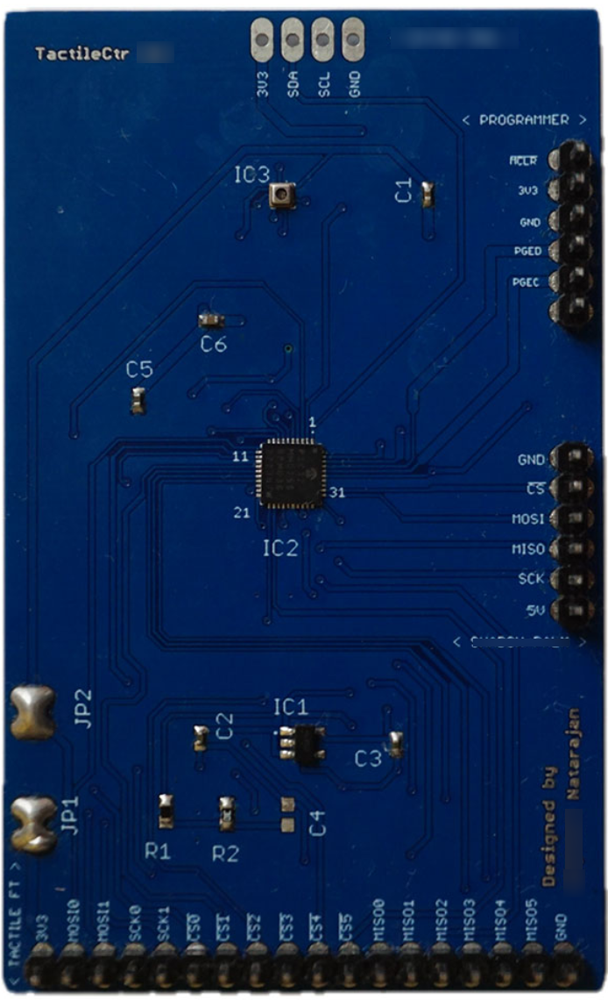
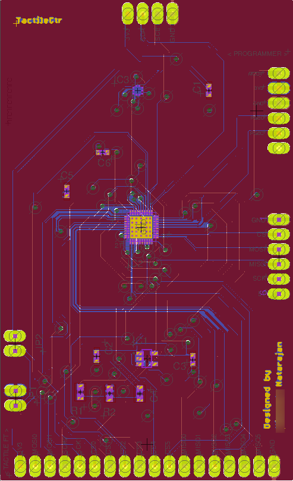
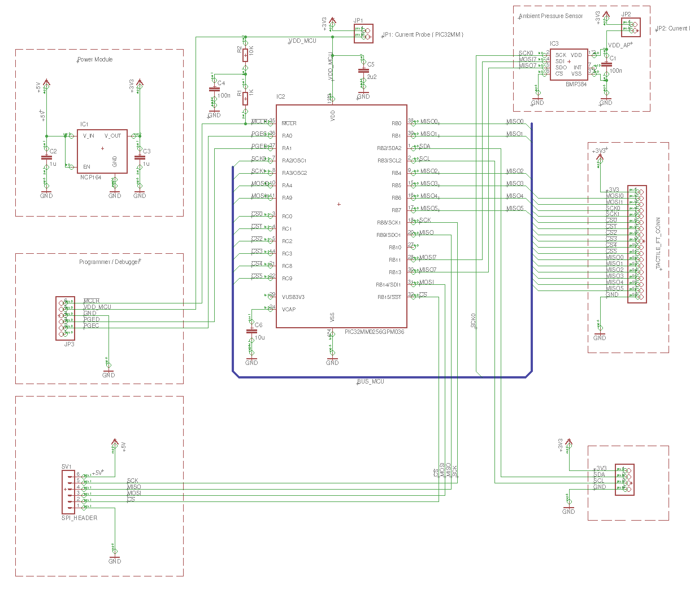

# TACLINK

> **A PIC32-based interface board for reading and routing 36-sensor tactile array data via I²C and SPI.**

**TACLINK** is an interface controller board designed to read and process tactile sensor data from a dedicated 36-sensor high-density tactile module *(currently under development)*. Powered by the PIC32MM0256GPM036 microcontroller in a UQFN-40 package, TACLINK is built to sample, manage, and route data from dense tactile arrays. It offers flexible communication options, utilizing I²C, Hardware SPI (HW SPI), and Software SPI (SW SPI) protocols.

## Features

- **Core Processing:** PIC32MM0256GPM036 microcontroller (UQFN-40 package)
- **High-Density Interfacing:** Designed to manage data from a 36-sensor tactile array
- **Dual-SPI Architecture:**
  - **Software SPI (SW SPI):** Dedicated to reading raw data from the upstream tactile sensor module.
  - **Hardware SPI (HW SPI):** High-speed data transmission to downstream external host systems.
- **Additional Protocols:** I²C support for expanded peripheral communication.
- **Target Applications:** Robotics, touch-sensitive interfaces, and pressure-mapping systems.

## Project Structure


```
taclink/
├── README.md
├── LICENSE
├── electronics/                    # Hardware design files
│   ├── schematic/                  # Circuit schematics (.sch)
│   ├── pcb/                        # Board layout (.brd)
│   ├── libraries/                  # Custom Eagle symbols and footprints (.lbr)
│   └── manufacturing/              # Production files
│       ├── gerbers/                # Gerber files for PCB fabrication
│       ├── BOM.csv                 # Bill of Materials
│       └── pick_and_place.csv      # Component placement file
├── firmware/                       # PIC32 source code
├── cad/                            # 3D models and enclosure files
│   ├── enclosure/                  # Case/housing STEP/STL files
│   └── assembly/                   # Assembly models
└── documents/                      # Documentation
    ├── datasheets/                 # Component datasheets
    ├── pinout/                     # Pin mapping diagrams
    └── guides/                     # User guides and application notes
```


## Use Case

TACLINK acts as the critical bridge between a high-density tactile sensing module (featuring 36 pressure sensors) and a host system. It communicates with the upstream sensor module using a Software SPI (SW SPI) protocol to continuously sample detailed pressure data. 

Designed for applications such as robotics, haptic interfaces, and pressure-mapping systems, TACLINK runs optimized firmware to acquire, process, and format the raw sensor readings. It then transmits this structured tactile data to an external system (such as a connected computer, robot controller, or external MCU) via a fast Hardware SPI (HW SPI) connection.

## Board Images

**Populated Module**  


**Board Layout**  


**Schematics**  


## Additional Details

- **Pin headers** are provided for programming the MCU and interfacing with external sensors and components.  
- **Low-power operation** and compact form factor make it ideal for embedded systems and portable tactile solutions.  
- Firmware development and sensor interfacing can be customized based on specific application needs.

---

## Usage, Attribution, and Licensing

This project is provided for **personal, academic, and research purposes only**. 

⛔ **Commercial use is strictly prohibited.** You may not use, modify, or build upon this design for any commercial or for-profit purpose without explicit prior written permission from the author.

If you use or adapt any part of this work for academic or research purposes, **you must credit the original author**:

**Vignesh Natarajan (Viki)**  
🌐 [vikisensorik.com](https://vikisensorik.com)

This project is licensed under the **Creative Commons Attribution-NonCommercial 4.0 International License (CC BY-NC 4.0)**.  
To view a copy of this license, visit: [https://creativecommons.org/licenses/by-nc/4.0/](https://creativecommons.org/licenses/by-nc/4.0/)

### Academic Citation
If you use this design or reference this work in academic research, publications, or theses, please cite this repository using the following BibTeX entry:

```bibtex
@misc{vnatarajan_taclink,
  author       = {Vignesh Natarajan (Viki)},
  title        = {TACLINK: A High-Density Tactile Controller Module},
  year         = {2025},
  howpublished = {\url{https://github.com/vikisensorik/taclink} and \url{https://vikisensorik.com}},
  note         = {Accessed: 2025-04-11}
}

